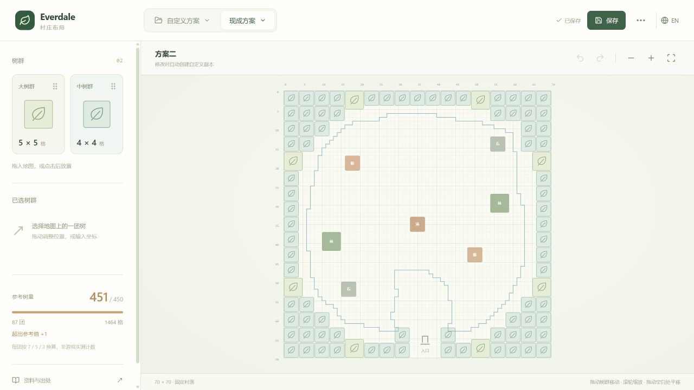

# Everdale Planner



[简体中文](README.md) · [Sources and provenance](docs/SOURCES.md) · [Architecture](docs/ARCHITECTURE.md)

An independent, browser-local village planner built with React, TypeScript and Vite.

Drag 5×5 and 4×4 groves, move existing groups, undo changes and save multiple custom layouts. Two reference templates are included. All layouts share the same seven fixed resource locations on a 70×70 map with the entrance at the bottom. Editing a template creates a custom copy. English and Simplified Chinese are supported throughout the interface.

## Development

Use Node.js 24 (minimum 22.12) and pnpm 11.25.0.

```sh
pnpm install
pnpm dev
pnpm check
pnpm build
pnpm preview
```

The production output is `dist/`. Open the Vite server URL, not index.html directly.

## Deploy

Upload this directory as a GitHub repository, keeping the lockfile and excluding node_modules, dist, environment files and private saves. For GitHub Pages, select **GitHub Actions** under **Settings → Pages**, then manually run **Deploy GitHub Pages**. CI runs checks on pushes and pull requests; deployment is explicitly triggered. Relative asset paths support repository subpaths.

For other static hosts: Node.js 24, install `pnpm install --frozen-lockfile`, build `pnpm build`, publish `dist`. No backend, secrets or rewrite rules are needed.

## Data and limitations

Custom layouts are saved in this browser only. Storage does not transfer between file URLs, localhost or deployed domains; export and import JSON to migrate. Legacy 70×70 JSON is supported, while fixed resource locations always come from the canonical project data.

The blue boundary is derived from game configuration and has not been tested tile by tile in game. Layout two contains 87 detected outer groups; the assumed 7/5 weighting gives 451, not 450. Its interior colored areas are not trees. See [the provenance document](docs/SOURCES.md).

Source code is MIT licensed. Game data, names, trademarks and third-party diagrams retain their respective rights. No game artwork, APKs or original reference images are bundled. This project is not affiliated with or endorsed by Supercell.
