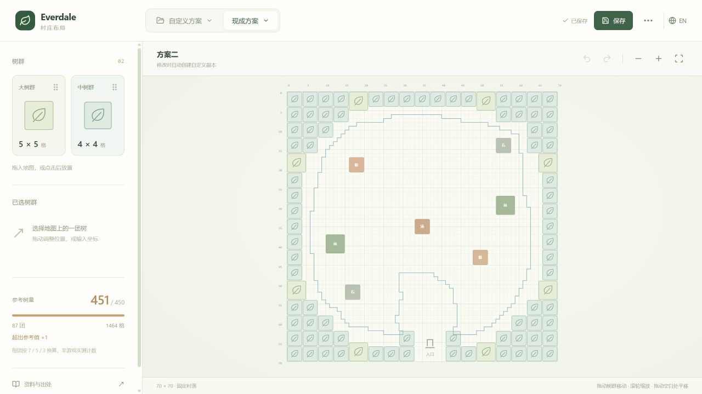

# Everdale Planner

[English](README.en.md) · [资料出处](docs/SOURCES.md) · [架构与扩展](docs/ARCHITECTURE.md)

面向个人村庄的社区布局工具。React + TypeScript + Vite，无后端、账户或云存储。



- 固定 70×70 村落和 7 个资源点，入口朝下；方案不能修改固定点。
- 拖放 5×5 / 4×4 树群，保留已有 2×2；网格吸附、碰撞检查、复制、删除、撤销与重做。
- 顶部区分现成方案和自定义方案；修改模板自动创建副本，草稿自动保存在当前浏览器。
- 方案一与方案二由参考图提取；方案二内圈不计作树。
- 中英文切换，JSON 导入/导出、旧编辑器 JSON 兼容、SVG 导出。
- 可关闭的蓝色建造参考线；已移除粉色刷新边界。

## 本地运行

需要 Node.js 24（最低 22.12）和 pnpm 11.25.0。

```sh
pnpm install
pnpm dev
```

开发服务器默认地址由 Vite 输出，通常为 http://127.0.0.1:5173。此项目使用模块构建，不能直接双击 index.html。

```sh
pnpm check   # TypeScript + 单元测试
pnpm build   # 静态生产文件输出到 dist/
pnpm preview # 本地预览生产构建
```

## 上传 GitHub 与建站

将本目录上传为仓库。不要上传 node_modules/、dist/、.env 或个人存档；这些已在 .gitignore 中排除。保留 pnpm-lock.yaml。

**GitHub Pages：** 仓库 Settings → Pages → Source 选择 GitHub Actions，然后在 Actions 中手动运行 **Deploy GitHub Pages**。工作流先检查和构建，再发布 dist/。部署默认手动触发，普通 push / PR 仅运行检查。Vite 使用相对 base，兼容 username.github.io/repository/ 子路径。

**其他静态站点：** 安装命令 `pnpm install --frozen-lockfile`，构建命令 `pnpm build`，发布目录 `dist`，Node.js 24。无需环境变量或服务器端路由重写。

## 数据与保存

所有用户方案只存在当前浏览器的 localStorage。`file://`、localhost、GitHub Pages 和自定义域名之间不共享浏览器存储。迁移时从旧页面导出 JSON，再通过新站“文件与设置 → 导入 JSON”导入。

固定点始终使用项目内的规范数据；导入文件不能替换它们。JSON 支持最多 500 团树、4900 个规划格，拒绝越界、重叠和无效尺寸。导入不会修改原模板。

蓝线来自静态配置推导，不是逐格游戏验证。方案二识别 8 团 5×5、79 团 4×4，按 7/5 换算为 451，项目保留原图结果，不强改成 450。详细依据见 [SOURCES.md](docs/SOURCES.md)。

## 许可

项目源代码使用 [MIT License](LICENSE)。游戏名称、提取的数据、第三方图片和相关商标不因该许可证而被重新授权。项目未包含 APK、游戏美术或用户提供的原始参考图片。与 Supercell 无隶属关系。
