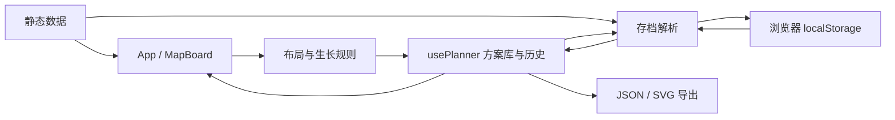

# 架构与开发 / Architecture

[项目介绍](../README.md) · [English overview](../README.en.md) · [资料出处](SOURCES.md)

## 设计选择

这是一个单页、纯静态的个人布局工具。React 负责界面，SVG 表达地图，TypeScript 纯函数处理布局与生长规则，localStorage 保存自定义方案。当前功能不需要服务端、数据库、路由框架或额外的全局状态库；GitHub Pages 可以直接托管构建产物。

这个分层适合目前的项目规模。后续应补足地图手势测试，并按界面职责拆分组件，而不是增加服务或抽象层。

## 目录职责

```text
src/
  main.tsx                 React 入口与语言 Provider
  App.tsx                  页面编排、菜单、工具栏与编辑命令
  components/
    MapBoard.tsx           SVG 地图、指针手势、平移缩放、放置预览
    GroveSymbol.tsx        树群图形与生长/选中状态
    MiniMap.tsx            方案卡片预览
    ProgressPanel.tsx      生长进度摘要
    SourcesDialog.tsx      应用内资料说明
    StorageNotice.tsx      保存异常、冲突与恢复操作
  hooks/usePlanner.ts      方案库、模板副本、撤销/重做与自动保存
  hooks/usePlanner.test.ts 保存、恢复和页面生命周期测试
  domain/
    types.ts               方案、树群、资源点等类型
    layout.ts              几何碰撞、计数、导入校验与导出协议
    progress.ts            生长状态切换与统计
    *.test.ts              规则、数据、序列化和导出的测试
  services/
    storage.ts             本地方案库、写锁、备份与损坏恢复
    storage.test.ts        损坏、冲突、配额及恢复回归测试
    export.ts              JSON 下载与独立 SVG 生成
  data/                    固定点、模板、建造区与参考色块
  i18n/                    中英文文案与语言状态
  styles.css               页面、地图和响应式样式
docs/SOURCES.md             数据来源、提取方法与不确定性
.github/workflows/ci.yml    检查、构建及 GitHub Pages 发布
```

依赖方向以 `components/hooks → domain` 为主；规则层不依赖 React。`services/storage.ts` 使用规范数据校验存档，`services/export.ts` 使用固定点与边界生成图片。`LibraryStorage` 集中处理所有方案库写入；`usePlanner` 负责 React 状态与保存时机，不直接写入 localStorage。



## 核心约定

### 地图与输入

- 地图为 70 × 70，坐标从 0 开始，X 向右、Y 向下，入口朝下。
- SVG 使用逻辑格单位。指针通过屏幕变换矩阵映射到地图坐标，再取整吸附网格。
- 拖动预览属于临时界面状态；落点通过地图边界、固定点和树群重叠检查后才写入方案。
- 蓝色建造参考线不是碰撞边界；方案二的参考色块不参与计数或碰撞。
- `FIXED_NODES` 是唯一的规范资源点集合。用户导入的固定点不会覆盖它。

### 方案与进度

模板 ID 使用 `preset-` 前缀。首次修改模板会创建自定义副本；导入也创建新 ID，避免覆盖现有方案。模板保护由应用逻辑实现，并未对数据对象做运行时冻结。

每个自定义方案具有独立的内存撤销/重做栈，编辑历史最多保留 80 步；历史不会写入存档，刷新后清空。自定义方案自动保存有 250 ms 延迟，切到后台或触发 `pagehide` 时通过同一安全保存入口尝试补写。存在未保存改动时注册离开提示；异步补写不能保证在浏览器强制退出时完成，应以界面的“已保存”为准。

`TreeGroup.grown` 是可选布尔值，缺失表示“待长成”。移动保留状态；新建、复制出的树群默认待长成。进度按完成的树群数计算百分比，7 / 5 / 3 的树量折算只是参考。JSON、SVG 和缩略图保留生长状态。

语言偏好独立存储。内置模板名称随语言切换，用户自定义名称不会被翻译。

### JSON 与存储

导出字段包括 `format: "everdale-planner"`、`version: 1`、`N: 70`、`id`、`name`、`groups`、`cells`、可选 `reference` 和 `updatedAt`。旧格式 `treeGroups` 仍可导入。

导入支持 2 / 4 / 5 的正方形树群，检查整数坐标、尺寸、重复树群 ID、越界、碰撞、生长字段和颜色值。最多接受 500 团树、4,900 个色块；单方案 JSON 限制为 2 MB，整库备份限制为 10 MB。完整解析成功后才添加方案。整库导入为每个方案创建新 ID 并追加到当前库，不覆盖已有方案；损坏恢复原文文件不作为普通方案导入。

| 存储键                          | 用途                      |
| ------------------------------- | ------------------------- |
| `everdale-planner.library.v1`   | 版本化方案库、当前方案 ID |
| `everdale.layout.boundaries.v2` | 兼容早期编辑器的旧存档    |
| `everdale.locale`               | 中英文偏好                |

浏览器存储按 origin 隔离，不会自动从 localhost 迁到 GitHub Pages，也不会跨设备同步。运行时不请求远程游戏资源或上传方案，点击资料链接才会跳转到外部页面。

## 存档保护与恢复

所有自动保存、手动保存、后台补写和恢复操作都由 `LibraryStorage` 处理。

- **读取失败不写入**：损坏、空字符串、未知库版本或不完整方案都进入保护状态，原始字节保留。读取被拒绝时也不会把默认空库自动写回。
- **上一份有效备份**：更改主存档前，先将上一份有效方案库写到 `everdale-planner.library.v1.backup`。任一写入失败都不会继续替换主存档。主存档损坏、或主存档丢失但备份仍在时，可加载这份备份供查看，但不会自动恢复写入。
- **显式恢复**：用户确认“恢复保存”后，先将主存档与备份原文一并归档到独立的 `everdale-planner.library.v1.recovery.<UUID>` 键，再备份并写入当前方案库。归档失败时保留原存档；也可以先下载原文供排查。归档保留在同一浏览器，不会上传。
- **跨页面冲突检查**：使用同 origin 的 [Web Locks](https://developer.mozilla.org/en-US/docs/Web/API/Web_Locks_API) 串行执行读取、版本比对和写入。写前比较读取时的原始内容；检测到其他页面写入或清空存储时暂停保存，保留当前内存编辑。`storage` / `pageshow` 事件用于及时显示冲突，即使事件尚未送达，写前检查仍有效。
- **冲突处理**：先“导出全部方案”，再确认“载入最新存档”，最后按需要重新导入备份；导入追加副本，保留两边方案。重载清空旧撤销历史并使排队中的旧写入失效。
- **能力限制**：不支持 Web Locks 的环境只允许内存编辑与导出，明确提示未保存，不退回有竞争风险的无锁写入。使用现代浏览器通过 HTTPS 访问；开发用 localhost 也支持安全上下文。部署更新后应刷新旧页面，使各页面使用相同保存协议。

“文件与设置 → 导出全部方案”生成 `format: "everdale-planner-library"` 的 JSON，可用“导入 JSON”恢复。原有单方案 JSON 继续兼容。浏览器自动备份与恢复归档仍会随站点数据清除而消失，不能代替下载到设备的备份。

## 构建与部署

本地环境和命令见 [README](../README.md#本地开发)。仓库中的 `package.json` 固定 pnpm 版本，`pnpm-lock.yaml` 锁定依赖，`pnpm-workspace.yaml` 中的 `allowBuilds` 允许 esbuild 的安装脚本；这个文件虽不声明多个包，仍有用途。

统一工作流为 `.github/workflows/ci.yml`：

1. push、pull request 和手动触发都会安装锁定依赖、执行 `pnpm check` 和 `pnpm build`。
2. 只有默认分支的 push 或手动运行会上传 `dist/` 为 Pages artifact。
3. 部署任务等待构建成功，再发布同一份产物。PR 和其他分支不具备部署入口；Pages 写权限只授予部署任务。

原先独立的 `deploy-pages.yml` 会在默认分支上重复安装、检查和构建，现已合并。每次工作流运行只构建一次。

在新仓库或 fork 中，需要先到 **Settings → Pages → Build and deployment → Source** 选择 **GitHub Actions**，再从默认分支运行工作流。GitHub Free 支持公开仓库的 Pages，私有仓库需要支持该功能的套餐，见 [GitHub 官方文档](https://docs.github.com/en/pages/getting-started-with-github-pages/using-custom-workflows-with-github-pages)。工作流本身不修改仓库可见性。

本仓库网站地址为 <https://z-voluntad.github.io/everdale-tree-planner/>。`vite.config.ts` 的 `base: './'` 生成相对资源地址，兼容项目子路径。其他静态托管使用 Node.js 24、`pnpm install --frozen-lockfile`、`pnpm build`，发布目录 `dist/`；不需要环境变量或服务端路由重写。

`package.json` 的 `private: true` 用于防止误发布到 npm，与 GitHub 仓库的公有/私有设置无关，应当保留。

## 验证与维护优先级

测试覆盖固定点、模板统计、碰撞、JSON 往返、旧存档迁移、SVG 转义、生长状态和文案键一致性。存储服务测试覆盖损坏原文保护、备份、恢复失败、存储配额、同时写入、外部清空和旧写入失效；jsdom 中的 React StrictMode 测试覆盖模板副本、撤销/重做、刷新持久化、跨页事件、退出保护、失败重试和整库备份导入。TypeScript 开启 strict。

后续维护建议：

| 优先级 | 问题与影响                                                                         | 建议                                                 |
| ------ | ---------------------------------------------------------------------------------- | ---------------------------------------------------- |
| 中     | `App.tsx` 仍混合菜单、快捷键、文件操作与编辑命令，样式文件较大。                   | 随后续功能按 Header、PlanMenu、SelectionPanel 拆分。 |
| 中     | jsdom 的写锁使用串行模拟，尚不等同于多浏览器实机验收；地图指针拖动尚无端到端测试。 | 在真实浏览器补充双页面保存和地图手势测试。           |
| 低     | `TREE_LIMIT` 已声明，但界面仍多处写死 450。                                        | 复用同一规则常量，减少修改遗漏。                     |

### 文件是否冗余

- 未发现内容完全相同的受版本控制文件。`README.md` / `README.en.md` 服务于不同语言，应同步维护；`SOURCES.md` 记录证据，不能用介绍页替代。
- `reference-two.json` 约 132 KiB、2,336 个色块，虽然行数多，但确实供地图的可选参考图层使用，不应直接删除。以后若模板增加，可考虑压缩表示或按需加载。
- `build-area.json`、`fixed-nodes.json` 和两个布局文件职责不同，均有运行时引用。
- `node_modules/`、`dist/`、`*.tsbuildinfo` 属于本地产物，已忽略，不应提交；锁文件、许可证和 `pnpm-workspace.yaml` 应保留。

## 扩展指南

### 添加参考方案

1. 在 `src/data/` 添加与 `layout-one.json` 同结构的 JSON。使用唯一的 `preset-` ID，树群宽高相等且只能为 2、4、5。
2. 在 `src/data/index.ts` 的 `templates` 数组注册数据和文案键；添加独立参考图层时再扩展 `Plan.reference` 与解析规则。
3. 在 `src/i18n/messages.ts` 同时补全中英文名称和说明。
4. 在 [SOURCES.md](SOURCES.md) 记录来源、作者/链接（若已知）、坐标转换、许可与不确定性。
5. 增加模板数量与几何合法性断言，运行 `pnpm check` 和 `pnpm build`。

### 添加语言

新增完整的 `Record<MessageKey, string>` 字典，扩展 `Locale` 类型、语言 Provider 和界面中的语言切换入口。不要翻译用户自定义名称。自动生成的副本名称在创建时写入，之后视为可编辑的用户文本。
